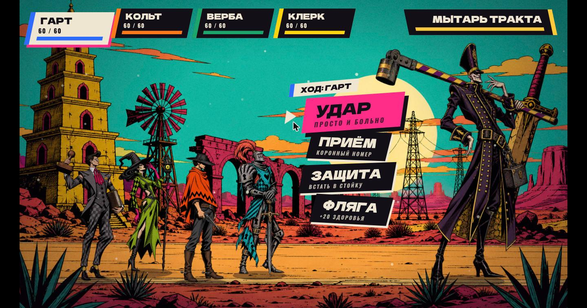
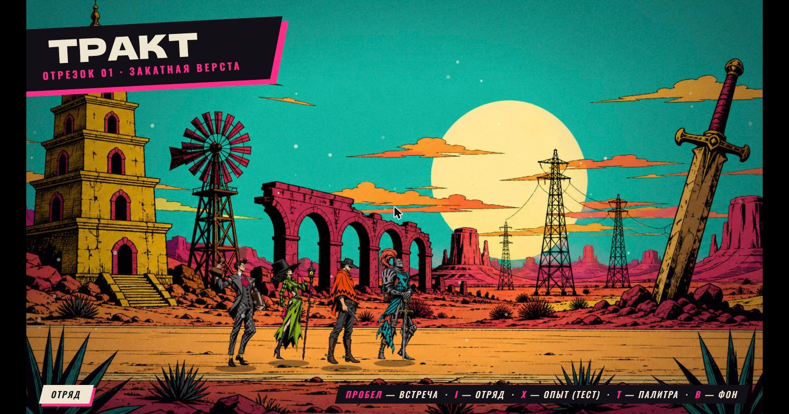

# Trakt (Тракт)

A visual prototype of a JRPG. Its only goal so far is to test the look, not the gameplay.

**[▶ Play in the browser](https://iansilent.github.io/trakt/)** · keyboard · UI in Russian

## The look

- Static, posed characters in heavy ink.
- A skewed, loud battle UI with a magenta accent and a violet and gold "threat mode".
- A party on the march along one endless road that runs through fragments of different worlds: fantasy, firearms, anything goes.

## What is in it

- A battle scene with a party of four and an enemy.
- A hero sheet (key `I`), equipment with five slots, levels and a small development tree. Items, branch names and numbers are placeholders.
- Keys: `Space` starts an encounter, `I` opens the party, `T` flips the palette, `B` switches the background between a generated picture and layers drawn in code.

## Art

Character sprites and the background in `gen/` are AI-generated placeholders (CellCog and SpriteCook). Everything else is drawn in code.

## Tech

One `index.html`, vanilla JavaScript, no build step. Fonts load from Google Fonts. The UI is in Russian.
